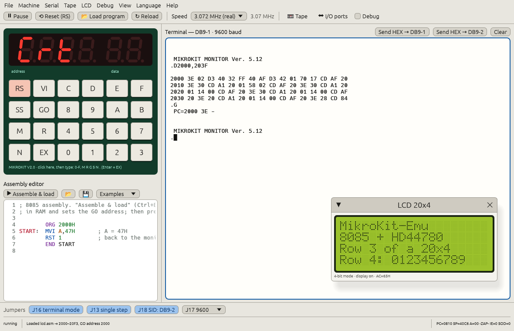

# MikroKit-Emu

**MikroKit-Emu** is an emulator of the Micro Design **Mikrokit V2.0**, an
Intel 8085 trainer made in Athens in the 1980s. It runs the kit's original
monitor ROM (v5.12) unchanged, cycle by cycle at the board's real 3.072 MHz,
and looks and behaves like the board.



The real Mikrokit, after a reset (the same `- 80 85` ready message):


## Features

- **The board**: 6-digit 7-segment display, 24-key keypad (click it or use
  your keyboard), RS and VI keys, and the jumpers.
- **Both monitors**: the keypad monitor and the terminal (CRT) monitor on
  serial port DB9-1, with single step and trace.
- **Built-in ROMs**: the original monitor 5.12, or the monitor plus
  **Palo Alto Tiny BASIC**; or load your own ROM.
- **Loading programs**: Intel HEX, raw binary or 8085 assembly source,
  assembled by the built-in assembler (also usable from the command line);
  or the kit's own serial download.
- **Tape recorder**: save and load programs as WAV files, compatible with
  a real kit's cassette interface.
- **I/O ports**: the 8155's ports as LEDs and switches, plus the X3 inputs.
- **HD44780 LCD**: a 16x2 or 20x4 character LCD on port B in 4-bit mode.
- **Debug panel**: registers, disassembly, breakpoints, memory view.
- **English and Greek** interface, light and dark themes.
- Linux, Windows (and macOS from source).

## Download

Ready-made builds are on the [Releases page](https://github.com/firew4lker/MikroKit-Emu/releases):

| File | For |
|---|---|
| `mikrokit-emu-linux-x86_64.tar.gz` | Linux (x86-64, glibc 2.44 or newer) |
| `mikrokit-emu-windows-x86_64.zip` | Windows 10 or newer (64-bit) |
| `mikrokit-emu-0.1.3-1-x86_64.pkg.tar.zst` | Arch Linux (`sudo pacman -U …`) |

## Documentation

- **User manual**: [English](docs/manual-en.md) ([PDF](docs/manual-en.pdf)) ·
  [Ελληνικά](docs/manual-el.md) ([PDF](docs/manual-el.pdf))
- **Schematic**: the board redrawn in KiCad, in [kicad/](kicad/)
  ([PDF](kicad/mikrokit.pdf), [notes](kicad/NOTES.md))
- **Original documentation**: the kit's manuals, schematic, monitor source,
  ROM image and a photo of the board, in [Original Documentation/](Original%20Documentation/)

## What's in this repository

| Folder | Contents |
|---|---|
| `src/`, `tests/` | the emulator (Rust, [egui](https://github.com/emilk/egui)) and its tests |
| `roms/` | the original monitor 5.12 and the monitor + Tiny BASIC (source and image) |
| `examples/` | example programs in assembly and Tiny BASIC |
| `docs/` | the user manuals (Markdown, HTML, PDF) and their screenshots |
| `kicad/` | the KiCad 10 schematic and the script that generates it |
| `Original Documentation/` | Micro Design's original manuals and files (Greek), and a photo of the board |
| `packaging/arch/` | the Arch Linux PKGBUILD |
| `assets/` | the icon and the desktop entry |

## Build and run

```bash
cargo run --release
```

Two monitor ROMs are built into the executable, so it needs no other
files. Choose one with **File → Monitor ROM**:

- **Original monitor 5.12** (the default): the kit's own EPROM,
  `roms/monitor-5.12.bin`. Only its sign-on text is changed, to
  "MIKROKIT MONITOR" (the EPROM says "MICROKIT").
- **Monitor 5.12 + Tiny BASIC**: `roms/monitor-basic.bin` (see below).
- **Load from file…**: your own ROM (`.bin`, `.hex`, or `.asm` source,
  which is assembled on the fly). The last file you used stays in the menu.

The choice is remembered, and switching resets the kit.

```
mikrokit-emu [--rom original|basic|PATH] [--terminal | --keypad] [--debug] [program.hex|.asm|.bin]
```


### Arch Linux

Install the package from the Releases page with `sudo pacman -U`, or build
it with the PKGBUILD in `packaging/arch/` (it downloads the source of the
release from GitHub):

```bash
cd packaging/arch && makepkg -si
```

The package installs `/usr/bin/mikrokit-emu`, a menu entry with an icon,
the manuals in `/usr/share/doc/mikrokit-emu` and the examples in
`/usr/share/mikrokit-emu/examples`.

### Windows

Ready-made: `mikrokit-emu-windows-x86_64.zip` from the Releases page (unzip, double-click
`mikrokit-emu.exe`; Windows 10 or newer, nothing to install). Settings are
kept in `%APPDATA%\MikroKit-Emu\data`. Command-line options work from a
Command Prompt as on Linux.

Graphics: the program draws with Vulkan or Direct3D 12 (Metal on macOS).
The window runs in a second process watched by the first, because some
graphics drivers crash outright when the window opens. If that happens (or
any other failure before the window appears), the program starts again
with OpenGL and remembers that OpenGL works on that PC (in the file
`renderer` in the settings folder). If OpenGL fails too, a message box
shows the reason and it is saved to `error.log` in the settings folder.
`--renderer wgpu` or `--renderer glow` chooses the method by hand;
`--renderer wgpu` also makes the program try Vulkan/Direct3D 12 again, for
example after a driver update.

To build it yourself on Windows, install Rust and run `cargo build
--release`. To cross-compile from Linux (needs the MinGW-w64 compiler):

```bash
rustup target add x86_64-pc-windows-gnu
cargo build --release --target x86_64-pc-windows-gnu
```

## Using it

- **Keypad monitor** (J16 off, the default): click the board, then type
  `0-F`, `M` `R` `G` `S` for M/R/GO/SS, `N` or Space for N, `.` or Enter for
  EX. F9 is RS (reset), F10 is VI. You can also click the keys.
- **Terminal monitor**: switch on *J16 terminal mode* in the bottom bar and
  press RS. Click the terminal and type; commands must be capitals, and
  *Serial → Type in capitals* (on by default) does that for you.
- **Loading programs**: *Load program* (toolbar or File menu), drag and drop,
  or a file on the command line.
  - `.hex` Intel HEX, `.asm` 8085 source (built-in assembler), `.bin` raw
    bytes at an address you choose.
  - The monitor's saved PC is set to the program start, so **GO EX** runs it.
  - End programs with `RST 1` (`CF`) to return to the monitor.
  - **Reload** re-reads the last file after you edit it.
- **The kit's own download**: `GO 1600 EX` (keypad) or `L` (terminal), then
  *Send HEX → DB9-2* (the default port) or *→ DB9-1* after selecting port 1
  with `GO 1800` / `P`.
- **Tape recorder** (📼 Tape): set J18 to tape, then record with
  `GO 1000 EX` (keypad) or `W` (terminal) — press *Record* just before the
  last EX / Return. Read back with `GO 1300 EX` or `R`, pressing *Play* the
  same way. Tapes are saved and loaded as WAV files, so you can also play
  them into a real Mikrokit, or record a real kit's tape to load here.
- **I/O ports** (⬌ I/O ports): the 8155's ports A, B and C on connector X2
  shown as LEDs (outputs) or clickable switches (inputs), following the
  8155's command register, plus the X3 inputs (port 3EH) and the timer.
  Try `examples/ports.asm` (switches → LEDs) and `examples/outputs.asm`
  (all three ports as outputs).
- **LCD** (*LCD* menu): plug a 16x2 or 20x4 HD44780-compatible character
  LCD into the 8155's port B, wired for 4-bit mode: PB2 = RS, PB3 = E,
  PB4–PB7 = D4–D7 (X2 pins 15, 16, 13, 14, 11, 12), D0–D3 and R/W to
  ground. The window shows the dot matrix (yellow-green or blue), the
  cursor and blinking, and warns when a program writes faster than a real
  module accepts (R/W is grounded, so programs can't read the busy flag
  and must wait: ~40 µs per byte, 1.52 ms after Clear or Home). The
  character set is the A00 ROM for 0x20–0x7F plus the 8 user-defined
  characters; of 0x80–0xFF only a few symbols are drawn (no katakana).
  Try `examples/lcd.asm`, or `examples/lcd.bas` in Tiny BASIC.
- **Copy and paste**: drag over terminal text to select it. Right-click
  the terminal for *Copy*, *Copy all text*, *Paste*, *Send Ctrl+C* and
  *Clear terminal*. With text selected, Ctrl+C copies; otherwise it sends
  ^C to the kit. Ctrl+V pastes (typed in at a person's pace).
- **Theme**: *View → Follow the system / Dark / Light*. In the light theme
  the terminal shows dark text on a light background.
  On Linux the desktop's choice is read from the freedesktop portal
  (`org.freedesktop.appearance color-scheme`), because the windowing
  library doesn't report it there; switching the desktop theme while the
  emulator runs is picked up too.
- **Language**: *Language → English / Ελληνικά*. English is the
  default; the choice is remembered. Menus, buttons, windows, messages
  and the help are translated. What the kit itself prints (the monitor,
  BASIC) stays as the ROM has it.
- **Debug panel**: registers, disassembly, breakpoints, memory view, the
  monitor's saved user registers, 8155 state. Pause and step the CPU.
- **File → Save memory range** writes RAM out as `.hex` or `.bin`.

See `examples/` for small programs.

## Tiny BASIC ROM

`roms/monitor-basic.asm` is the original monitor 5.12 plus **Palo Alto Tiny
BASIC 2.0** (Li-Chen Wang, Roger Rauskolb, 1976, "@COPYLEFT ALL WRONGS
RESERVED"), squeezed into the ROM's free areas (18E1H–1FFFH and
10FBH–12FFH). `roms/monitor-basic.bin` is the same thing as an 8 KB image,
ready for a 2764 EPROM. Both images are built into the emulator; after
rebuilding the `.bin`, rebuild the emulator too. The keypad monitor, the terminal monitor and the
programs at 1000H/1300H/1600H/1800H are unchanged.

Pick *File → Monitor ROM → Monitor 5.12 + Tiny BASIC*, or:

```bash
cargo run --release -- --terminal --rom basic
```

Type `B` at the terminal monitor's `.` prompt. BASIC uses the user RAM
2000H–3FFFH (about 7.9 KB for programs). `BYE` returns to the monitor, and
`B` comes back with the program still there.

- Statements: `LET` (optional), `PRINT`, `INPUT`, `IF` (no `THEN`),
  `GOTO`, `GOSUB`/`RETURN`, `FOR`/`NEXT`/`STEP`, `REM`, `STOP`, plus
  `POKE addr,val`, `OUT port,val`, `BYE`.
- Commands: `RUN`, `LIST [n]`, `NEW`. Ctrl+C stops a program.
- Functions: `RND(n)`, `ABS(n)`, `SIZE`, `PEEK(addr)`, `IN(port)`.
- 16-bit integers, variables `A`–`Z` and the array `@(i)`. Statements can
  be shortened with a dot: `P.` = `PRINT`. `#` means "not equal".
- Example: `examples/leds.bas` counts on the 8155 port A LEDs. Send it with
  *Send HEX → DB9-1* (`.bas` files are typed in at a person's pace).

Changes to the monitor: the `B` command and its help line (the repeated
footer of help page 2 made room for it), the sign-on text, and help page 2
now ends with a proper 00. To rebuild the image after editing the source:

```bash
cargo run --release -- --assemble roms/monitor-basic.asm -o roms/monitor-basic.bin
```

The `--assemble` option assembles any 8085 source (`-o file.bin` gives the
8 KB ROM image, `-o file.hex` Intel HEX, `--symbols` prints the symbol
table).

## How faithful is it

- The CPU counts clock cycles exactly at 3.072 MHz, so the monitor's
  timing-dependent code works unchanged: single step / trace (8155 timer →
  TRAP after one instruction), the 9600-baud software serial port on SID, and
  the tape routines' delay loops.
- Chips emulated: 8085 (including RIM/SIM, all interrupts and the
  undocumented instructions), 8279, 8155 (RAM, ports, timer), 8251, the
  input buffer IC21 (J16 on port 0FH, the X3 inputs on port 3EH), and the
  cassette interface. I/O and memory decoding follow the schematic (see the
  KiCad redraw in [kicad/](kicad/)).
- Tape: recording turns the SOD square wave into audio through a high-pass
  filter, like the recorder's AC-coupled input. Playback models the board's
  LM324 circuit as an envelope detector (SID = 1 while a tone is present).
  When recording stops, the recorder's stop click is written too: the
  monitor's read routine waits for the next sound after the checksum byte,
  so a perfectly silent tape would leave it waiting forever.
- The terminal holds typed characters until the monitor stops printing,
  because the monitor's output routine reads and discards input that arrives
  while it prints (on the real board, typing ahead loses characters).
  File sends go at full line speed.
- Typing in the terminal: spaces, Enter, Backspace, Esc, Ctrl+C/S/Q and
  paste all go to the kit.
- Not yet emulated: the DB9-2 transmit side (SOD as a serial port), the
  8155 handshake modes (ALT3/ALT4) and port interrupts, memory options
  other than 2764 + 6264.

## Tests

```bash
cargo test
```

The tests assemble `Original Documentation/Monitor Program.asm` and check it matches the ROM
byte for byte, then boot the real ROM and drive it: keypad M/GO/R, `-Err`
on ROM writes, single step (including the manual's example), the VI key,
downloads over DB9-1 and DB9-2, a terminal session, and tape write → WAV
→ read round trips from both the keypad and the terminal monitor.

## License

MikroKit-Emu is free software: you can redistribute it and/or modify it
under the terms of the GNU General Public License as published by the Free
Software Foundation, either version 3 of the License, or (at your option)
any later version. See [LICENSE](LICENSE).

This covers the emulator, the documentation and the KiCad redraw written
for this project. It does not cover the Mikrokit's original material: the
monitor ROM v5.12 (built into the emulator and in `roms/`), the original
schematic and the manuals in `Original Documentation/` are Micro Design
Ltd's work and are included for preservation and reference. Palo Alto Tiny
BASIC is by Li-Chen Wang and Roger Rauskolb (1976, "@COPYLEFT ALL WRONGS
RESERVED").
