# Εγχειρίδιο χρήσης του MicroKit-Emu

*Εξομοιωτής του εκπαιδευτικού συστήματος 8085 Microkit V2.0 της Micro Design (Αθήνα, 1985)*

---

## Περιεχόμενα

1. [Εισαγωγή](#1-εισαγωγή)
2. [Εγκατάσταση και εκκίνηση](#2-εγκατάσταση-και-εκκίνηση)
3. [Το κύριο παράθυρο](#3-το-κύριο-παράθυρο)
4. [Το monitor πληκτρολογίου](#4-το-monitor-πληκτρολογίου)
5. [Το monitor τερματικού](#5-το-monitor-τερματικού)
6. [Φόρτωση και εκτέλεση προγραμμάτων](#6-φόρτωση-και-εκτέλεση-προγραμμάτων)
7. [Γράφοντας δικά σας προγράμματα](#7-γράφοντας-δικά-σας-προγράμματα)
8. [ROM του monitor και Tiny BASIC](#8-rom-του-monitor-και-tiny-basic)
9. [Το κασετόφωνο](#9-το-κασετόφωνο)
10. [Οι θύρες I/O](#10-οι-θύρες-io)
11. [Η οθόνη LCD](#11-η-οθόνη-lcd)
12. [Ο πίνακας αποσφαλμάτωσης](#12-ο-πίνακας-αποσφαλμάτωσης)
13. [Βραχυκυκλωτήρες (jumpers)](#13-βραχυκυκλωτήρες-jumpers)
14. [Εμφάνιση και γλώσσα](#14-εμφάνιση-και-γλώσσα)
15. [Πίνακες αναφοράς](#15-πίνακες-αναφοράς)
16. [Επίλυση προβλημάτων](#16-επίλυση-προβλημάτων)

---

## 1. Εισαγωγή

Το **Microkit** είναι ένας εκπαιδευτικός υπολογιστής με τον
μικροεπεξεργαστή Intel 8085, κατασκευασμένος από τη Micro Design Ltd στην
Αθήνα τη δεκαετία του 1980. Έχει οθόνη έξι ψηφίων LED, πληκτρολόγιο 24
πλήκτρων, δύο σειριακές θύρες, σύνδεση για κασετόφωνο και ακροδέκτη
παράλληλων θυρών. Το ενσωματωμένο του πρόγραμμα, το **monitor** (έκδοση
5.12), σας επιτρέπει να εξετάζετε και να αλλάζετε τη μνήμη και τους
καταχωρητές, να εκτελείτε προγράμματα εντολή προς εντολή, να φορτώνετε
προγράμματα από σειριακή γραμμή και να τα αποθηκεύετε σε κασέτα.

Το **MicroKit-Emu** αναπαράγει την πλακέτα στον υπολογιστή σας. Εκτελεί
αυτούσιο το αρχικό πρόγραμμα monitor από την EPROM του κιτ, με τον
επεξεργαστή να τρέχει στην πραγματική ταχύτητα της πλακέτας (3.072 MHz,
μετρώντας κάθε κύκλο ρολογιού). Έτσι τα προγράμματα συμπεριφέρονται όπως
στο πραγματικό κιτ, μαζί και οι χρονισμοί τους.

Τα μέρη της πλακέτας που εξομοιώνονται:

| Μέρος | Ολοκληρωμένο | Σε τι χρησιμεύει |
|---|---|---|
| Επεξεργαστής | 8085 | εκτελεί τα πάντα |
| Ελεγκτής πληκτρολογίου/οθόνης | 8279 | το πληκτρολόγιο και η οθόνη 6 ψηφίων |
| RAM, θύρες I/O, χρονιστής | 8155 | θύρες A, B, C στον ακροδέκτη X2· βηματική εκτέλεση |
| Σειριακή θύρα DB9-1 | 8251 | το τερματικό |
| Σειριακή θύρα DB9-2 | SID/SOD του 8085 | λήψη προγραμμάτων |
| Σύνδεση κασετοφώνου | LM324 | αποθήκευση και φόρτωση προγραμμάτων σε «κασέτα» |
| Απομονωτής εισόδου | 74LS125 | ο βραχυκυκλωτήρας J16 και οι είσοδοι X3 |

Προαιρετικά, όπως και στο πραγματικό κιτ: μια ROM με **Tiny BASIC** και
μια **οθόνη χαρακτήρων LCD HD44780**.

---

## 2. Εγκατάσταση και εκκίνηση

### Linux (έτοιμο πρόγραμμα)

Αποσυμπιέστε το αρχείο και εκτελέστε το πρόγραμμα:

```bash
tar xzf microkit-emu-linux-x86_64.tar.gz
./microkit-emu/microkit-emu
```

Ο φάκελος περιέχει επίσης το README και τον φάκελο `examples` με τα
παραδείγματα. Το έτοιμο πρόγραμμα χρειάζεται πρόσφατο Linux (glibc 2.44 ή
νεότερο).

### Windows (έτοιμο πρόγραμμα)

Αποσυμπιέστε το `microkit-emu-windows-x86_64.zip` και κάντε διπλό κλικ
στο `microkit-emu.exe` μέσα στον φάκελο `microkit-emu`. Χρειάζεται Windows
10 ή νεότερα και τίποτε άλλο. Ο φάκελος περιέχει επίσης το README, τα
εγχειρίδια και τον φάκελο `examples`.

Αν ο οδηγός γραφικών δεν υποστηρίζει τον κανονικό τρόπο σχεδίασης του
προγράμματος (Vulkan ή Direct3D 12), το πρόγραμμα ξεκινά ξανά μόνο του με
OpenGL. Αν αποτύχει και αυτό, ένα μήνυμα εξηγεί την αιτία και η αναφορά
αποθηκεύεται στο `%APPDATA%\MicroKit-Emu\data\error.log`. Συνήθως
βοηθά η ενημέρωση του οδηγού γραφικών· σε εικονική μηχανή, ενεργοποιήστε
την επιτάχυνση 3D.

### Μεταγλώττιση από τον πηγαίο κώδικα (Linux, Windows, macOS)

Εγκαταστήστε τη Rust από το <https://rustup.rs> και στον φάκελο
`emulator` εκτελέστε:

```bash
cargo run --release
```

### Γραμμή εντολών

```
microkit-emu [επιλογές] [program.hex | program.asm | program.bin]
```

| Επιλογή | Σημασία |
|---|---|
| `--rom original` | εκκίνηση με το αρχικό monitor 5.12 (προεπιλογή) |
| `--rom basic` | εκκίνηση με το monitor + Tiny BASIC |
| `--rom ΑΡΧΕΙΟ` | δική σας ROM (`.bin`, `.hex` ή `.asm`) |
| `--terminal` | εκκίνηση σε λειτουργία τερματικού (J16 on) |
| `--keypad` | εκκίνηση σε λειτουργία πληκτρολογίου (J16 off) |
| `--debug` | άνοιγμα του πίνακα αποσφαλμάτωσης |
| `πρόγραμμα` | φόρτωση αυτού του προγράμματος στη RAM κατά την εκκίνηση |
| `--assemble SRC [-o OUT] [--symbols]` | συμβολομετάφραση αρχείου χωρίς άνοιγμα παραθύρου (βλ. [ενότητα 7](#7-γράφοντας-δικά-σας-προγράμματα)) |

Ο εξομοιωτής θυμάται τις ρυθμίσεις σας (ROM, βραχυκυκλωτήρες, θέμα,
γλώσσα, ανοιχτά παράθυρα) από τη μία χρήση στην επόμενη.

---

## 3. Το κύριο παράθυρο

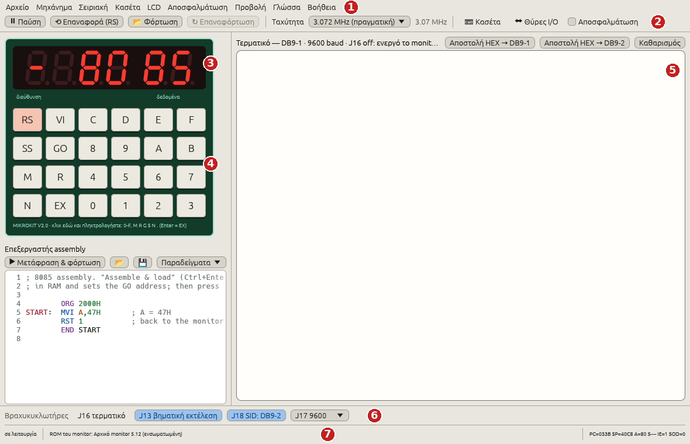

1. **Γραμμή μενού**: Αρχείο, Μηχάνημα, Σειριακή, Κασέτα, LCD,
   Αποσφαλμάτωση, Προβολή, Γλώσσα, Βοήθεια.
2. **Γραμμή εργαλείων**: παύση/εκτέλεση της CPU, επαναφορά (το πλήκτρο RS),
   φόρτωση και επαναφόρτωση προγράμματος, επιλογή ταχύτητας (πραγματική
   3.072 MHz ή Turbo), άνοιγμα του κασετοφώνου, του παραθύρου θυρών I/O
   και του πίνακα αποσφαλμάτωσης. Ο αριθμός δίπλα στην ταχύτητα είναι η
   ταχύτητα που πραγματικά επιτυγχάνεται.
3. **Οθόνη**: τα έξι ψηφία του κιτ. Τα τέσσερα αριστερά δείχνουν
   διεύθυνση, τα δύο δεξιά δεδομένα.
4. **Πληκτρολόγιο**: πατήστε τα πλήκτρα με το ποντίκι ή χρησιμοποιήστε το
   πληκτρολόγιο του υπολογιστή (βλ. [ενότητα 4](#4-το-monitor-πληκτρολογίου)).
5. **Τερματικό**: η οθόνη ενός τερματικού συνδεδεμένου στη σειριακή θύρα
   DB9-1.
6. **Βραχυκυκλωτήρες**: οι πιο συχνά χρησιμοποιούμενοι βραχυκυκλωτήρες της
   πλακέτας ([ενότητα 13](#13-βραχυκυκλωτήρες-jumpers)).
7. **Γραμμή κατάστασης**: αν τρέχει η CPU, το τελευταίο μήνυμα και οι
   καταχωρητές της CPU (ενημερώνονται τέσσερις φορές το δευτερόλεπτο).

**Πού πηγαίνει ό,τι πληκτρολογείτε.** Το πληκτρολόγιο του κιτ και το
τερματικό χρησιμοποιούν και τα δύο το πληκτρολόγιο του υπολογιστή. Κάντε
κλικ στην πλακέτα για να πληκτρολογείτε στο κιτ ή στο τερματικό για να
γράφετε εκεί. Το μέρος που δέχεται τα πλήκτρα έχει χρωματιστό πλαίσιο.

---

## 4. Το monitor πληκτρολογίου

Το monitor πληκτρολογίου λειτουργεί όταν ο βραχυκυκλωτήρας **J16 είναι
off** (προεπιλογή). Μετά από επαναφορά (RS) η οθόνη δείχνει το μήνυμα
ετοιμότητας:

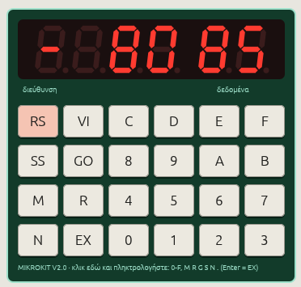

Η παύλα στα αριστερά σημαίνει ότι το monitor περιμένει μια διαταγή.

### Τα πλήκτρα

| Πλήκτρο κιτ | Πλήκτρο υπολογιστή | Σημασία |
|---|---|---|
| 0–F | 0–9, A–F | δεκαεξαδικά ψηφία |
| M | M | εξέταση/αλλαγή μνήμης |
| R | R | εξέταση/αλλαγή καταχωρητών |
| GO | G | εκτέλεση προγράμματος |
| SS | S | βηματική εκτέλεση (μία εντολή κάθε φορά) |
| N | N, διάστημα ή κόμμα | επόμενο |
| EX | . (τελεία) ή Enter | εκτέλεση / τέλος της διαταγής |
| RS | F9 | επαναφορά (reset) |
| VI | F10 | διακοπή (RST 7.5, άλμα στη 40DFH) |

Τα ψηφία μπαίνουν στην οθόνη από τα δεξιά· αν πληκτρολογήσετε περισσότερα
ψηφία από όσα χρειάζονται, μετράνε μόνο τα τελευταία. Ένα λάθος πλήκτρο
εμφανίζει **-Err**· η παύλα σημαίνει ότι το monitor περιμένει ακόμη
διαταγή:

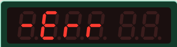

### M: εξέταση και αλλαγή μνήμης

Πατήστε **M**, πληκτρολογήστε μια διεύθυνση τεσσάρων ψηφίων και μετά
**N**. Η οθόνη δείχνει τη διεύθυνση και το byte που είναι αποθηκευμένο
εκεί:

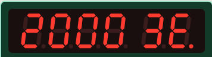

- Πληκτρολογήστε δύο δεκαεξαδικά ψηφία για να αλλάξετε το byte.
- Το **N** το αποθηκεύει και πηγαίνει στην επόμενη διεύθυνση:

  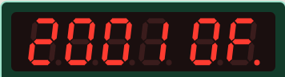

- Το **M** (μέσα στη διαταγή) πηγαίνει μία διεύθυνση πίσω.
- Το **EX** τερματίζει τη διαταγή.

Η μνήμη της ROM (0000–1FFF) δεν αλλάζει: η προσπάθεια εμφανίζει -Err.

### R: εξέταση και αλλαγή καταχωρητών

Πατήστε **R**. Η οθόνη δείχνει τον καταχωρητή A:

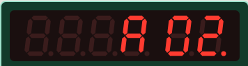

Πατήστε **N** για τον επόμενο καταχωρητή, με αυτή τη σειρά: A, B, C, D, E,
F (σημαίες), I (μάσκα διακοπών), H, L, SPH, SPL, PCH, PCL. Πληκτρολογήστε
νέα δεδομένα για να αλλάξετε έναν καταχωρητή και **EX** για να
τελειώσετε. Αυτές είναι οι τιμές που αποθήκευσε το monitor όταν σταμάτησε
τελευταία φορά το πρόγραμμά σας (με RST 1 ή σε σημείο διακοπής).

### GO: εκτέλεση προγράμματος

Πατήστε **GO**. Η οθόνη δείχνει τη διεύθυνση από την οποία θα ξεκινήσει
το πρόγραμμα (τον αποθηκευμένο μετρητή προγράμματος) και το byte που
βρίσκεται εκεί. Πληκτρολογήστε άλλη διεύθυνση αν θέλετε και πατήστε
**EX** για εκτέλεση. Ένα πρόγραμμα επιστρέφει στο monitor με την εντολή
`RST 1` (κωδικός CF)· τότε η οθόνη δείχνει ξανά το μήνυμα ετοιμότητας.

### SS: βηματική εκτέλεση

Πατήστε **SS**, πληκτρολογήστε τη διεύθυνση έναρξης (ή κρατήστε αυτή που
εμφανίζεται) και πατήστε **N**. Η CPU εκτελεί **μία** εντολή και η οθόνη
δείχνει την επόμενη διεύθυνση και το πρώτο της byte. Κάθε **N** εκτελεί
μία ακόμη εντολή· ενδιάμεσα μπορείτε να δείτε τους καταχωρητές με το R.
Το **EX** τερματίζει. Η βηματική εκτέλεση χρειάζεται τον J13 on.

### Ενσωματωμένα προγράμματα

Αυτά τα προγράμματα της ROM ξεκινούν με GO *διεύθυνση* EX:

| Διεύθυνση | Πρόγραμμα | Τι δείχνει η οθόνη |
|---|---|---|
| 1000 | εγγραφή μνήμης σε κασέτα | `S Ad` (διεύθυνση αρχής), `E Ad` (διεύθυνση τέλους), `S rC` (ξεκινήστε το κασετόφωνο) |
| 1300 | ανάγνωση κασέτας στη μνήμη | `S rC` (ξεκινήστε το κασετόφωνο) |
| 1600 | λήψη αρχείου Intel HEX | `End` όταν τελειώσει |
| 1800 | επιλογή θύρας για το 1600 | `POrt` και ο αριθμός θύρας· πατήστε 1 ή 2 και μετά EX |

---

## 5. Το monitor τερματικού

Για το monitor τερματικού ενεργοποιήστε τον **J16 τερματικό** στη γραμμή
βραχυκυκλωτήρων και πατήστε **RS**. Το monitor σας χαιρετά στο τερματικό
και δείχνει το σήμα αναμονής του, μια τελεία. Κάντε κλικ στο τερματικό και
πληκτρολογήστε διαταγές:

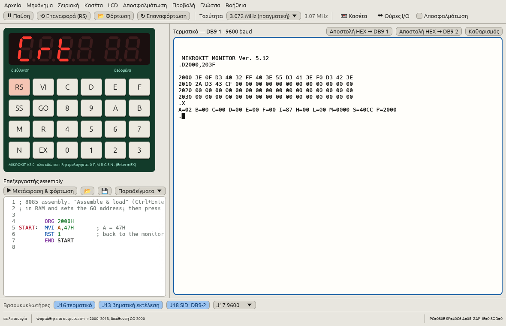

Οι διαταγές γράφονται με κεφαλαία· η επιλογή **Σειριακή → Πληκτρολόγηση με
κεφαλαία** (ενεργή εξ αρχής) το κάνει για εσάς. Πατήστε **H** για τις
σελίδες βοήθειας (το ίδιο το monitor τις εμφανίζει στα αγγλικά):

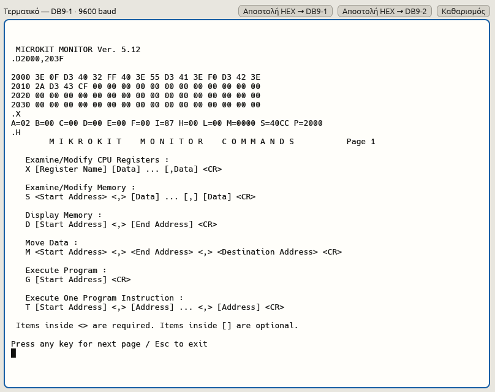

| Διαταγή | Σημασία |
|---|---|
| `X [καταχ.] [δεδ.] … <CR>` | εξέταση/αλλαγή καταχωρητών CPU |
| `S διεύθ, [δεδ.] … <CR>` | εξέταση/αλλαγή μνήμης |
| `D [αρχή], [τέλος] <CR>` | εμφάνιση μνήμης |
| `M αρχή, τέλος, προορισμός <CR>` | μετακίνηση (αντιγραφή) μνήμης |
| `G [διεύθ] <CR>` | εκτέλεση προγράμματος |
| `T [διεύθ], … <CR>` | ιχνηλάτηση: εκτέλεση εντολή προς εντολή |
| `F αρχή, τέλος, δεδ. <CR>` | γέμισμα μνήμης |
| `E διεύθ <CR> δεδ.… <Esc>` | εισαγωγή bytes στη μνήμη |
| `I θύρα, … <CR>` | ανάγνωση θύρας εισόδου |
| `O θύρα, δεδ. <CR>` | εγγραφή σε θύρα εξόδου |
| `P` | επιλογή σειριακής θύρας για το `L` |
| `L` | φόρτωση αρχείου Intel HEX |
| `W` | εγγραφή μνήμης σε κασέτα |
| `R` | ανάγνωση κασέτας |
| `H` | βοήθεια |
| `B` | Tiny BASIC (μόνο με τη ROM Tiny BASIC) |

Ό,τι βρίσκεται μέσα σε `<>` είναι υποχρεωτικό, ό,τι μέσα σε `[]`
προαιρετικό. `<CR>` είναι το πλήκτρο Enter.

### Πληκτρολόγηση στο τερματικό

- Το **Enter** στέλνει CR· τα **Backspace**, **Esc** και **Tab** δουλεύουν
  κανονικά.
- Το **Ctrl+C** στέλνει ^C (σταματά ένα πρόγραμμα BASIC). Αν έχετε
  επιλέξει κείμενο, το Ctrl+C το αντιγράφει.
- Τα **Ctrl+S / Ctrl+Q** στέλνουν XOFF/XON.
- Το **Ctrl+V** επικολλά· το κείμενο πληκτρολογείται με ανθρώπινο ρυθμό.
- Με **δεξί κλικ** στο τερματικό: *Αντιγραφή*, *Αντιγραφή όλου του
  κειμένου*, *Επικόλληση*, *Αποστολή Ctrl+C*, *Καθαρισμός τερματικού*.

Το πραγματικό monitor αγνοεί τα πλήκτρα που πατιούνται όσο τυπώνει. Ο
εξομοιωτής κρατά ό,τι πληκτρολογείτε μέχρι να τελειώσει το monitor, έτσι
δεν χάνεται τίποτα.

---

## 6. Φόρτωση και εκτέλεση προγραμμάτων

### Φόρτωση προγράμματος

Χρησιμοποιήστε τη **Φόρτωση** (γραμμή εργαλείων), το **Αρχείο → Φόρτωση
προγράμματος** ή σύρετε ένα αρχείο στο παράθυρο. Μορφές αρχείων:

| Αρχείο | Περιεχόμενο |
|---|---|
| `.hex` | Intel HEX: οι διευθύνσεις προέρχονται από το αρχείο |
| `.asm` | πηγαίος κώδικας 8085: τον μεταφράζει ο ενσωματωμένος συμβολομεταφραστής |
| `.bin` | σκέτα bytes: σας ζητείται η διεύθυνση φόρτωσης |

Μετά τη φόρτωση η γραμμή κατάστασης δείχνει πού μπήκε το πρόγραμμα, και ο
αποθηκευμένος μετρητής προγράμματος του monitor ορίζεται στην αρχή του.
Έτσι, σε λειτουργία πληκτρολογίου πατήστε απλώς **GO** και **EX**, ή
γράψτε **G** και Enter στο τερματικό. (Μπορείτε να το απενεργοποιήσετε
στο **Αποσφαλμάτωση → Ορισμός διεύθυνσης GO μετά τη φόρτωση
προγράμματος**.)

Η **Επαναφόρτωση** φορτώνει ξανά το τελευταίο αρχείο: διορθώστε τον
κώδικα σε οποιονδήποτε επεξεργαστή κειμένου, αποθηκεύστε, πατήστε
Επαναφόρτωση και εκτελέστε ξανά.

Τα προγράμματα μπαίνουν στη RAM (2000–3FFF). Η φόρτωση στην περιοχή της
ROM απορρίπτεται.

### Η λήψη προγραμμάτων του ίδιου του κιτ

Το πραγματικό κιτ δέχεται προγράμματα από σειριακό καλώδιο. Το ίδιο
γίνεται και στον εξομοιωτή:

1. Ξεκινήστε το πρόγραμμα λήψης: **GO 1600 EX** (πληκτρολόγιο) ή **L**
   (τερματικό).
2. Στείλτε το αρχείο: **Αποστολή HEX → DB9-2** (η προεπιλεγμένη θύρα του
   προγράμματος λήψης) ή **Αποστολή HEX → DB9-1**, αφού επιλέξετε τη θύρα
   1 με **GO 1800** (πληκτρολόγιο) ή **P** (τερματικό).

### Αποθήκευση μνήμης

Το **Αρχείο → Αποθήκευση περιοχής μνήμης** αποθηκεύει μια περιοχή
διευθύνσεων σε αρχείο Intel HEX ή δυαδικό.

---

## 7. Γράφοντας δικά σας προγράμματα

Γράψτε κώδικα 8085 σε οποιονδήποτε επεξεργαστή κειμένου και φορτώστε
απευθείας το αρχείο `.asm`. Ένα ελάχιστο πρόγραμμα:

```asm
        ORG 2000H
START:  MVI A,47H       ; A = 47H
        RST 1           ; επιστροφή στο monitor
        END START
```

Φορτώστε το, πατήστε GO και EX και μετά R: ο καταχωρητής A δείχνει 47.

**Τελειώνετε τα προγράμματά σας με `RST 1`** (κωδικός CF). Τότε το monitor
αποθηκεύει όλους τους καταχωρητές για να τους δείτε και εμφανίζει ξανά το
σήμα αναμονής του.

Ο συμβολομεταφραστής καταλαβαίνει ετικέτες (με ή χωρίς άνω-κάτω τελεία),
`EQU`, `SET`, `ORG`, `DB`, `DW`, `DS`, `END`, συμβολοσειρές, σταθερές
χαρακτήρων και εκφράσεις με `+ - * / MOD SHL SHR AND OR XOR NOT HIGH LOW`.
Οι αριθμοί γράφονται `2000H`, `0x2000`, `$2000`, `1010B`, `17O` ή `17Q`. Τα
λάθη αναφέρονται με τον αριθμό της γραμμής τους.

Για συμβολομετάφραση χωρίς άνοιγμα παραθύρου:

```bash
microkit-emu --assemble program.asm -o program.hex
microkit-emu --assemble program.asm -o program.bin --symbols
```

Η έξοδος `.bin` είναι πλήρης εικόνα ROM 8 KB (0000–1FFF), χρήσιμη για να
φτιάξετε τη δική σας ROM monitor.

### Παραδείγματα

| Αρχείο | Τι κάνει |
|---|---|
| `hello.hex` | βάζει 47H στον καταχωρητή A και επιστρέφει |
| `count.asm` | μετρά 00–FF στην οθόνη, με τη ρουτίνα οθόνης του monitor |
| `ports.asm` | αντιγράφει τους διακόπτες της θύρας B στα LED της θύρας A |
| `outputs.asm` | κάνει όλες τις θύρες του 8155 εξόδους με σταθερό σχέδιο |
| `lcd.asm` | γράφει τέσσερις γραμμές στην LCD |
| `leds.bas` | Tiny BASIC: μετρά στο δυαδικό στα LED της θύρας A |
| `lcd.bas` | Tiny BASIC: γράφει στην LCD και μετρά 0–999 |

### Χρήσιμες διευθύνσεις

| Διεύθυνση | Περιεχόμενο |
|---|---|
| 2000–3FFF | η RAM σας |
| 4000–40FF | η RAM του 8155· το monitor χρησιμοποιεί τις 40CD–40FF |
| 40D3 / 40D6 / 40D9 / 40DC | θέσεις άλματος για RST 5, RST 6, RST 6.5, RST 7 |
| 40DF | θέση άλματος για το VI (RST 7.5) |
| 40E2–40EE | οι καταχωρητές που αποθηκεύει το monitor |
| 40FF | αντίγραφο του καταχωρητή εντολών του 8155 (ενημερώστε το όταν αλλάζετε τον CSR) |

---

## 8. ROM του monitor και Tiny BASIC

Επιλέξτε ROM από το **Αρχείο → ROM του monitor**:

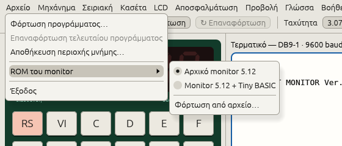

- **Αρχικό monitor 5.12**: η EPROM του κιτ (προεπιλογή).
- **Monitor 5.12 + Tiny BASIC**: το ίδιο monitor με την Palo Alto Tiny
  BASIC στον ελεύθερο χώρο της ROM.
- **Φόρτωση από αρχείο…**: δική σας ROM. Το τελευταίο αρχείο μένει στο
  μενού.

Η αλλαγή ROM κάνει επαναφορά στο κιτ. Και οι δύο ROM είναι ενσωματωμένες
στον εξομοιωτή.

### Tiny BASIC

Με τη ROM Tiny BASIC, τον J16 on (λειτουργία τερματικού) και αφού
πατήσετε RS, γράψτε **B** στο σήμα αναμονής του monitor:

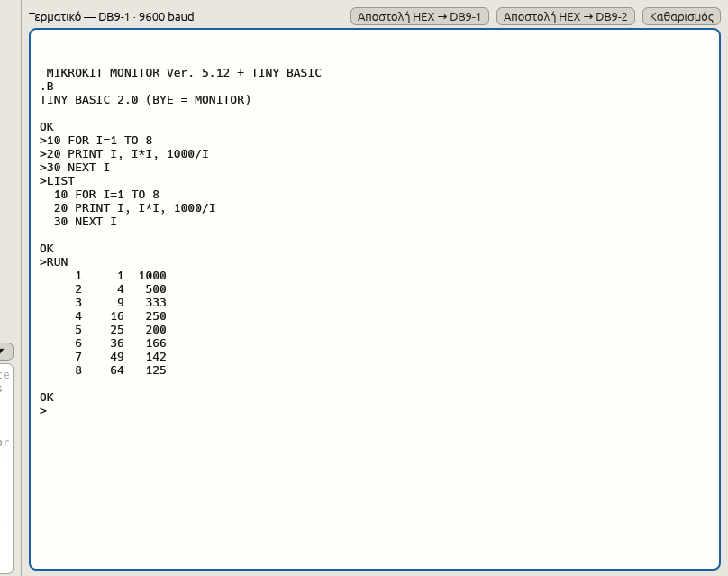

- **Εντολές**: `LET` (προαιρετικό), `PRINT`, `INPUT`, `IF` (χωρίς `THEN`),
  `GOTO`, `GOSUB`/`RETURN`, `FOR`/`NEXT`/`STEP`, `REM`, `STOP`,
  `POKE διεύθ,τιμή`, `OUT θύρα,τιμή`, `BYE`.
- **Διαταγές**: `RUN`, `LIST [γραμμή]`, `NEW`. Το **Ctrl+C** σταματά ένα
  πρόγραμμα.
- **Συναρτήσεις**: `RND(n)`, `ABS(n)`, `SIZE` (ελεύθερη μνήμη),
  `PEEK(διεύθ)`, `IN(θύρα)`.
- Οι αριθμοί είναι ακέραιοι 16 bit (−32768 έως 32767). Μεταβλητές είναι τα
  `A`–`Z` και το `@(i)` είναι πίνακας. Το `#` σημαίνει «διάφορο». Οι
  εντολές συντομεύονται με τελεία: `P.` = `PRINT`.
- Τα προγράμματα βρίσκονται στη RAM 2000–3EFF (περίπου 7.9 KB).
- Το **BYE** επιστρέφει στο monitor· με **B** επιστρέφετε και το πρόγραμμα
  είναι ακόμη εκεί.

Για να φορτώσετε πρόγραμμα BASIC από αρχείο κειμένου, χρησιμοποιήστε την
**Αποστολή HEX → DB9-1** με αρχείο `.bas`: ο εξομοιωτής το πληκτρολογεί
γραμμή προς γραμμή.

---

## 9. Το κασετόφωνο

Το Microkit αποθηκεύει προγράμματα σε απλό κασετόφωνο. Ο εξομοιωτής έχει
ένα εικονικό κασετόφωνο που αποθηκεύει τις «κασέτες» ως αρχεία ήχου WAV:
μπορείτε ακόμη και να τις παίξετε σε πραγματικό Microkit ή να ηχογραφήσετε
την κασέτα ενός πραγματικού κιτ και να τη φορτώσετε.

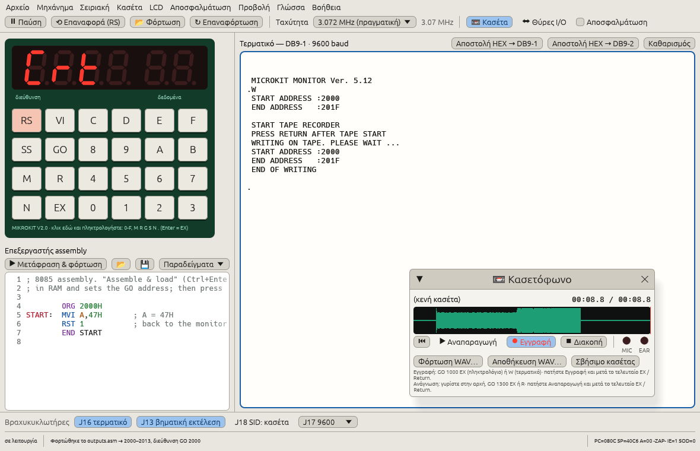

**Πρώτα βάλτε τον J18 στην κασέτα** (κάντε κλικ στο *J18 SID* στη γραμμή
βραχυκυκλωτήρων ώστε να γράφει *κασέτα*). Το παράθυρο του κασετοφώνου σας
το θυμίζει αν το ξεχάσετε.

### Εγγραφή σε κασέτα

1. Ξεκινήστε το πρόγραμμα εγγραφής: **GO 1000 EX** (πληκτρολόγιο) ή **W**
   (τερματικό).
2. Δώστε τις διευθύνσεις αρχής και τέλους.
3. Όταν το monitor ζητήσει να ξεκινήσετε το κασετόφωνο (`S rC` στην
   οθόνη), πατήστε **Εγγραφή** στο παράθυρο του κασετοφώνου και μετά **EX**
   (ή Enter).
4. Περιμένετε μέχρι το monitor να δείξει ξανά το σήμα αναμονής. Η
   **Αποθήκευση WAV…** κρατά την κασέτα σε αρχείο.

### Ανάγνωση από κασέτα

1. **Φόρτωση WAV…** (ή χρησιμοποιήστε την κασέτα που μόλις γράψατε) και
   πατήστε **⏮** (γύρισμα στην αρχή).
2. Ξεκινήστε το πρόγραμμα ανάγνωσης: **GO 1300 EX** ή **R**.
3. Πατήστε **Αναπαραγωγή** και μετά **EX** (ή Enter).

Η λυχνία MIC δείχνει το σήμα προς το κασετόφωνο, η EAR το σήμα που
επιστρέφει. Κάντε κλικ στην κυματομορφή για να μετακινήσετε την κεφαλή.

---

## 10. Οι θύρες I/O

Το παράθυρο **Θύρες I/O** (γραμμή εργαλείων ή μενού Προβολή) δείχνει τον
ακροδέκτη παράλληλων θυρών X2 και τον απομονωτή εισόδου:

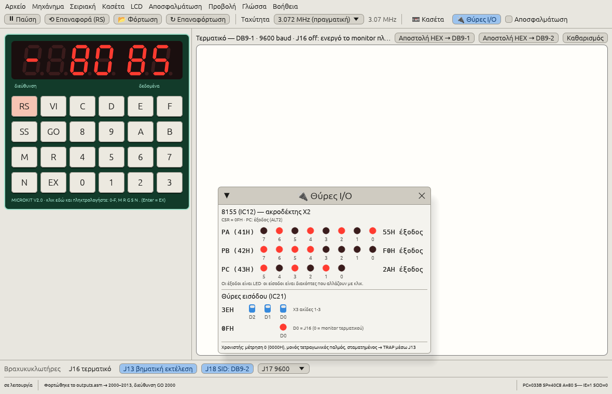

- Οι **θύρες A, B και C** του 8155 (διευθύνσεις I/O 41H, 42H, 43H). Μια
  θύρα ρυθμισμένη ως **έξοδος** εμφανίζεται ως κόκκινα LED· μια θύρα
  ρυθμισμένη ως **είσοδος** εμφανίζεται ως μπλε διακόπτες που αλλάζουν με
  κλικ. Η κατεύθυνση ακολουθεί τον καταχωρητή εντολών του 8155 (θύρα 40H).
- **Θύρα 3EH**: οι τρεις είσοδοι του ακροδέκτη X3 (bits D0–D2).
- **Θύρα 0FH**: ο βραχυκυκλωτήρας J16 στο bit D0 (0 = monitor τερματικού).
- Ο **χρονιστής** του 8155, που χρησιμοποιεί το monitor για τη βηματική
  εκτέλεση.

Δοκιμάστε το `outputs.asm` (και οι τρεις θύρες έξοδοι) και το `ports.asm`
(οι διακόπτες της θύρας B ανάβουν τα LED της θύρας A).

---

## 11. Η οθόνη LCD

Μπορείτε να συνδέσετε μια οθόνη χαρακτήρων LCD **16x2** ή **20x4**
(συμβατή με HD44780) στη θύρα B του 8155, σε λειτουργία 4 bit. Επιλέξτε
την από το μενού **LCD**:

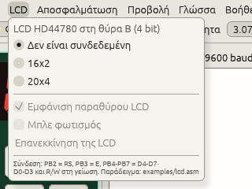

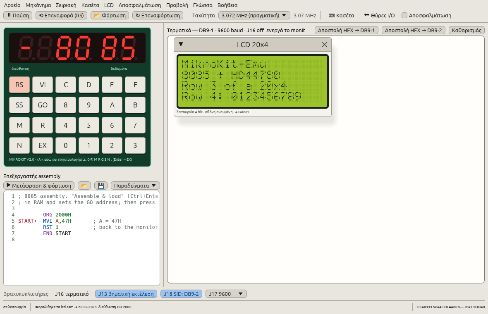

### Συνδεσμολογία

| Ακίδα 8155 | Ακροδέκτης X2 | LCD |
|---|---|---|
| PB2 | ακίδα 15 | RS |
| PB3 | ακίδα 16 | E |
| PB4 | ακίδα 13 | D4 |
| PB5 | ακίδα 14 | D5 |
| PB6 | ακίδα 11 | D6 |
| PB7 | ακίδα 12 | D7 |
| — | γείωση | D0–D3, R/W |
| — | ακίδες 2, 4 (+5V) / 1, 3 (γείωση) | τροφοδοσία |

### Προγραμματισμός

- Κάντε τη θύρα B έξοδο: γράψτε 02H στον καταχωρητή εντολών του 8155
  (θύρα 40H) και κρατήστε αντίγραφο στη 40FFH.
- Στείλτε κάθε byte σε δύο μισά (πρώτα τα τέσσερα υψηλά bits) στις
  PB4–PB7, με το RS στην PB2 (0 = εντολή, 1 = χαρακτήρας), και δώστε έναν
  παλμό στο E (PB3), πάνω και κάτω, για κάθε μισό.
- Εκκίνηση: στείλτε 3, 3, 3 και μετά 2 (ως μεμονωμένα μισά) για να
  περάσει η LCD σε λειτουργία 4 bit, και μετά τις εντολές 28H (2 γραμμές),
  0CH (οθόνη αναμμένη), 01H (καθαρισμός) και 06H (μετακίνηση δεξιά).
- Επειδή το R/W είναι γειωμένο, το πρόγραμμα δεν μπορεί να ρωτήσει την
  LCD αν είναι έτοιμη· πρέπει να περιμένει: περίπου 40 µs μετά από κάθε
  byte και 1.6 ms μετά από Clear (01H) ή Home (02H). Αν το πρόγραμμά σας
  είναι πολύ γρήγορο, το παράθυρο της LCD δείχνει προειδοποίηση: μια
  πραγματική LCD μπορεί να χάσει αυτά τα bytes.

Το `examples/lcd.asm` δείχνει όλα τα παραπάνω· το `examples/lcd.bas` κάνει
το ίδιο σε Tiny BASIC (η BASIC είναι αρκετά αργή ώστε να μη χρειάζεται
καθυστερήσεις).

Το μενού προσφέρει επίσης **μπλε φωτισμό** και **Επανεκκίνηση της LCD**.
Πριν την αρχικοποιήσει ένα πρόγραμμα, μια πραγματική LCD δείχνει μια
σειρά από σκούρα τετράγωνα· το ίδιο κάνει και η εξομοιωμένη.

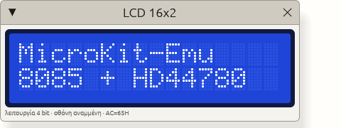

Η LCD εμφανίζει όλους τους βασικούς χαρακτήρες (κωδικοί 20H–7FH), τους
οκτώ χαρακτήρες που σχεδιάζετε μόνοι σας (κωδικοί 00H–07H) και μερικά
σύμβολα από το πάνω μισό (°, µ, Ω, π, το γεμάτο τετράγωνο). Οι ιαπωνικοί
χαρακτήρες katakana εμφανίζονται κενοί.

---

## 12. Ο πίνακας αποσφαλμάτωσης

Ανοίξτε τον με την **Αποσφαλμάτωση** στη γραμμή εργαλείων:

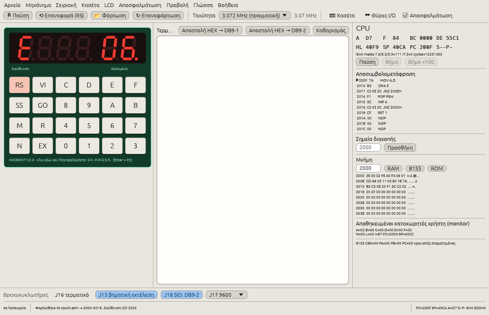

- **CPU**: όλοι οι καταχωρητές, οι σημαίες και η κατάσταση των διακοπών.
- **Παύση / Εκτέλεση, Βήμα, Βήμα ×100**: σταματήστε τη CPU και εκτελέστε
  μία ή εκατό εντολές.
- **Αποσυμβολομετάφραση**: οι επόμενες εντολές· το ▶ δείχνει την τρέχουσα,
  το ● ένα σημείο διακοπής.
- **Σημεία διακοπής**: γράψτε μια διεύθυνση και πατήστε Προσθήκη. Η CPU
  σταματά όταν τη φτάσει.
- **Μνήμη**: 64 bytes από οποιαδήποτε διεύθυνση (γρήγορα κουμπιά για RAM,
  8155 και ROM).
- **Αποθηκευμένοι καταχωρητές χρήστη (monitor)**: ό,τι θα δείξει η διαταγή
  R.
- Η κατάσταση των θυρών και του χρονιστή του **8155**.

Η ταχύτητα **Turbo** (γραμμή εργαλείων) τρέχει τη CPU όσο πιο γρήγορα
μπορεί ο υπολογιστής σας, χρήσιμο για μεγάλα προγράμματα BASIC. Ό,τι
εξαρτάται από χρονισμούς (η κασέτα, η σειριακή θύρα DB9-2) εξακολουθεί να
δουλεύει, γιατί ακολουθεί το εξομοιωμένο ρολόι.

---

## 13. Βραχυκυκλωτήρες (jumpers)

Η γραμμή βραχυκυκλωτήρων στο κάτω μέρος αλλάζει τους βραχυκυκλωτήρες της
πλακέτας· το μενού **Μηχάνημα** έχει τις ίδιες ρυθμίσεις.

| Βραχυκυκλωτήρας | Θέση | Αποτέλεσμα |
|---|---|---|
| **J16** | on / off | monitor τερματικού / monitor πληκτρολογίου (πατήστε RS μετά την αλλαγή) |
| **J13** | on | ο χρονιστής του 8155 οδηγεί το TRAP (χρειάζεται για SS και T) |
| **J18** | DB9-2 / κασέτα | τα SID και SOD πηγαίνουν στη σειριακή θύρα DB9-2 ή στην κασέτα |
| **J17** | θέση 1–11 | ταχύτητα της DB9-1: 9600 (θέση 1), 4800, 2400, 1200, 600, 300 … |
| **J14** | on | η RAM του 8155 είναι ενεργή στη 4000H |

Οι υπόλοιποι βραχυκυκλωτήρες της πλακέτας (J1–J12) ρυθμίζουν τη γείωση
των διακοπών και τους τύπους των μνημών. Ο εξομοιωτής είναι μόνιμα στη
βασική ρύθμιση: EPROM 2764 και RAM 6264.

---

## 14. Εμφάνιση και γλώσσα

- Το **Προβολή → Όπως το σύστημα / Σκούρο / Ανοιχτό** επιλέγει τα χρώματα.
  Στο ανοιχτό θέμα το τερματικό δείχνει σκούρο κείμενο σε ανοιχτό φόντο:

  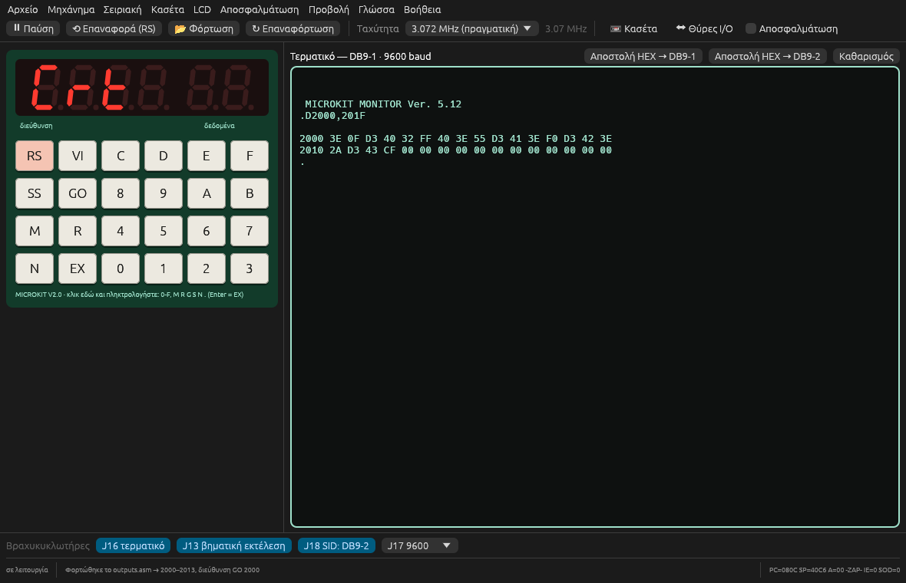

- Το **Γλώσσα → English / Ελληνικά** αλλάζει όλο το πρόγραμμα μεταξύ
  αγγλικών και ελληνικών. Το κείμενο που τυπώνει το ίδιο το κιτ (το
  monitor, η BASIC) μένει όπως είναι στη ROM.
- Από την **Προβολή** ανοίγουν επίσης το κασετόφωνο, οι θύρες I/O και ο
  πίνακας αποσφαλμάτωσης.

---

## 15. Πίνακες αναφοράς

### Χάρτης μνήμης

| Διευθύνσεις | Περιεχόμενο |
|---|---|
| 0000–1FFF | ROM του monitor (EPROM 2764) |
| 2000–3FFF | RAM χρήστη (6264) |
| 4000–40FF | RAM του 8155 (επαναλαμβάνεται έως τη 47FF)· το monitor χρησιμοποιεί το πάνω μέρος |

### Θύρες I/O

| Θύρα | Συσκευή |
|---|---|
| 0FH | J16 (bit 0) |
| 1EH / 1FH | 8251 δεδομένα / έλεγχος-κατάσταση (DB9-1) |
| 2EH / 2FH | 8279 δεδομένα / έλεγχος (πληκτρολόγιο, οθόνη) |
| 3EH | είσοδοι X3 (bits 0–2) |
| 40H | καταχωρητής εντολών/κατάστασης του 8155 |
| 41H / 42H / 43H | θύρες A / B / C του 8155 |
| 44H / 45H | χρονιστής του 8155 (χαμηλό / υψηλό) |

### Διακοπές

| Διακοπή | Πηγή | Το monitor τη στέλνει |
|---|---|---|
| TRAP | χρονιστής 8155 (μέσω J13) | βηματική εκτέλεση |
| RST 7.5 | πλήκτρο VI | 40DF |
| RST 6.5 | ακροδέκτης X1 | 40D9 |
| RST 5.5 | 8279 (πληκτρολόγιο) | το monitor |

### Συντομεύσεις πληκτρολογίου

| Πλήκτρο | Λειτουργία πληκτρολογίου | Τερματικό |
|---|---|---|
| 0–9, A–F | δεκαεξαδικά ψηφία | πληκτρολογούνται |
| M, R, G, S | M, R, GO, SS | πληκτρολογούνται |
| N, διάστημα, κόμμα | N | πληκτρολογούνται |
| . ή Enter | EX | Enter = CR |
| F9 | RS | RS |
| F10 | VI | VI |
| Ctrl+C | — | ^C, ή αντιγραφή της επιλογής |
| Ctrl+V | — | επικόλληση |

---

## 16. Επίλυση προβλημάτων

| Πρόβλημα | Λύση |
|---|---|
| Δεν γίνεται τίποτα όταν πληκτρολογώ | Κάντε κλικ στο μέρος όπου θέλετε να γράψετε (πλακέτα ή τερματικό)· αποκτά χρωματιστό πλαίσιο. |
| Το τερματικό μένει άδειο | Ενεργοποιήστε τον *J16 τερματικό* και πατήστε RS. |
| Το monitor αγνοεί τις διαταγές μου | Οι διαταγές γράφονται με κεφαλαία· κρατήστε ενεργό το *Σειριακή → Πληκτρολόγηση με κεφαλαία*. |
| Η βηματική εκτέλεση δεν κάνει τίποτα | Ο J13 πρέπει να είναι on. |
| Η κασέτα δεν γράφει ή δεν διαβάζει | Ο J18 πρέπει να είναι στην *κασέτα*. Πατήστε Εγγραφή/Αναπαραγωγή **πριν** το τελευταίο EX. Γυρίστε στην αρχή πριν την ανάγνωση. |
| Η λήψη δεν φτάνει | Στείλτε στη θύρα που ακούει το πρόγραμμα λήψης (εξ ορισμού DB9-2· επιλογή με GO 1800 ή P). |
| Το πρόγραμμά μου δεν επιστρέφει | Τελειώστε το με `RST 1`. Πατήστε RS για να επιστρέψει το monitor. |
| Η LCD δείχνει σκούρα τετράγωνα | Το πρόγραμμα δεν την έχει αρχικοποιήσει ακόμη ή η θύρα B δεν είναι έξοδος. |
| Το παράθυρο της LCD προειδοποιεί για εγγραφές ενώ είναι απασχολημένη | Προσθέστε καθυστερήσεις: 40 µs ανά byte, 1.6 ms μετά από Clear/Home. |

---

*MicroKit-Emu. Το Microkit σχεδιάστηκε από τη Micro Design Ltd. Η Tiny
BASIC είναι η Palo Alto Tiny BASIC των Li-Chen Wang και Roger Rauskolb
(1976).*
