# MikroKit-Emu User Manual

*An emulator of the Micro Design Mikrokit V2.0 8085 trainer (Athens, 1985)*

---

## Contents

1. [Introduction](#1-introduction)
2. [Installing and starting](#2-installing-and-starting)
3. [The main window](#3-the-main-window)
4. [The keypad monitor](#4-the-keypad-monitor)
5. [The terminal monitor](#5-the-terminal-monitor)
6. [Loading and running programs](#6-loading-and-running-programs)
7. [Writing your own programs](#7-writing-your-own-programs)
8. [Monitor ROMs and Tiny BASIC](#8-monitor-roms-and-tiny-basic)
9. [The tape recorder](#9-the-tape-recorder)
10. [The I/O ports](#10-the-io-ports)
11. [The LCD](#11-the-lcd)
12. [The debug panel](#12-the-debug-panel)
13. [Jumpers](#13-jumpers)
14. [Appearance and language](#14-appearance-and-language)
15. [Reference tables](#15-reference-tables)
16. [Troubleshooting](#16-troubleshooting)

---

## 1. Introduction

The **Mikrokit** is an educational computer built around the Intel 8085
microprocessor, made by Micro Design Ltd in Athens in the 1980s. It has a
six-digit LED display, a 24-key keypad, two serial ports, a cassette
interface and a parallel I/O connector. Its built-in program, the
**monitor** (version 5.12), lets you examine and change memory and
registers, run programs one instruction at a time, load programs over a
serial line and save them on tape.

**MikroKit-Emu** reproduces the board on your computer. It runs the
original monitor program from the kit's EPROM (only its sign-on text is
changed, to "MIKROKIT MONITOR"), with the CPU
running at the board's real speed (3.072 MHz, counted clock cycle by clock
cycle), so programs behave as they do on the real kit, including their
timing.

Emulated parts of the board:

| Part | Chip | What you use it for |
|---|---|---|
| CPU | 8085 | runs everything |
| Keyboard/display controller | 8279 | the keypad and the 6-digit display |
| RAM, I/O ports, timer | 8155 | ports A, B, C on connector X2; single step |
| Serial port DB9-1 | 8251 | the terminal |
| Serial port DB9-2 | 8085 SID/SOD | program downloads |
| Cassette interface | LM324 | saving and loading programs on "tape" |
| Input buffer | 74LS125 | jumper J16 and inputs X3 |

Optional extras that the real kit can also have: a **Tiny BASIC** ROM and
an **HD44780 character LCD**.

---

## 2. Installing and starting

### Linux (ready-made program)

Unpack the archive and run the program:

```bash
tar xzf mikrokit-emu-linux-x86_64.tar.gz
./mikrokit-emu/mikrokit-emu
```

The folder also contains this manual's README and the `examples` folder
with the sample programs. The ready-made program needs a recent Linux
(glibc 2.44 or newer).

### Windows (ready-made program)

Unzip `mikrokit-emu-windows-x86_64.zip` and double-click
`mikrokit-emu.exe` in the `mikrokit-emu` folder. It needs Windows 10 or
newer and nothing else. The folder also has the README, the manuals and the
`examples` folder.

If the graphics driver can't run the program's normal drawing method
(Vulkan or Direct3D 12), even if it crashes, the program starts again with
OpenGL and remembers that OpenGL works on that PC. If that fails too, a
message explains why and the report is saved in
`%APPDATA%\MikroKit-Emu\data\error.log`. Updating the graphics driver
usually helps; in a virtual machine, turn on 3D acceleration. After a
driver update, start it once with `mikrokit-emu.exe --renderer wgpu` to use
the normal method again.

### Building from the source code (Linux, Windows, macOS)

Install Rust from <https://rustup.rs>, then in the `emulator` folder run:

```bash
cargo run --release
```

### Command line

```
mikrokit-emu [options] [program.hex | program.asm | program.bin]
```

| Option | Meaning |
|---|---|
| `--rom original` | start with the original monitor 5.12 (the default) |
| `--rom basic` | start with the monitor + Tiny BASIC |
| `--rom FILE` | use your own ROM (`.bin`, `.hex` or `.asm`) |
| `--terminal` | start in terminal mode (jumper J16 on) |
| `--keypad` | start in keypad mode (jumper J16 off) |
| `--debug` | open the debug panel |
| `--renderer wgpu` / `glow` | drawing method: Vulkan/Direct3D 12 or OpenGL (automatic by default) |
| `program` | load this program into RAM at start-up |
| `--assemble SRC [-o OUT] [--symbols]` | assemble a file without opening the window (see [section 7](#7-writing-your-own-programs)) |

The emulator remembers your settings (ROM, jumpers, theme, language, open
windows) from one session to the next.

---

## 3. The main window

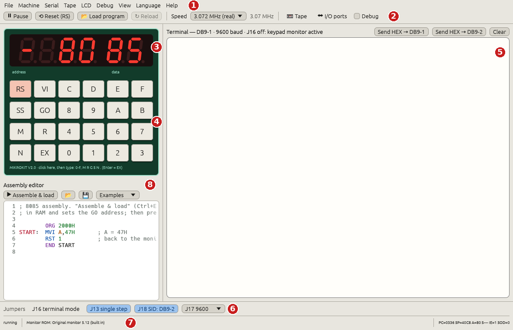

1. **Menu bar**: File, Machine, Serial, Tape, LCD, Debug, View, Language,
   Help.
2. **Toolbar**: pause/run the CPU, reset (the RS key), load and reload a
   program, choose the speed (real 3.072 MHz or Turbo), and open the tape
   recorder, the I/O ports window and the debug panel. The number next to
   the speed is the speed actually achieved.
3. **Display**: the kit's six digits. The left four show an address, the
   right two show data.
4. **Keypad**: click the keys with the mouse, or use your computer's
   keyboard (see [section 4](#4-the-keypad-monitor)).
5. **Terminal**: the screen of a terminal connected to serial port DB9-1.
6. **Jumpers**: the board's most-used jumpers ([section 13](#13-jumpers)).
7. **Status bar**: whether the CPU is running, the latest message, and the
   CPU registers (updated four times a second).
8. **Assembly editor**: write 8085 assembly and load it into RAM with one
   click ([section 7](#the-assembly-editor)).

**Where your typing goes.** The keypad and the terminal both use your
keyboard. Click the board to type on the keypad, or click the terminal to
type there. The part that receives your typing has a coloured frame. While
you type in the assembly editor, the keys go only to the editor.

---

## 4. The keypad monitor

The keypad monitor runs when jumper **J16 is off** (the default). After a
reset (RS), the display shows the ready message:

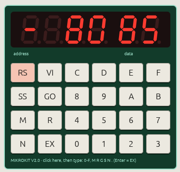

The dash on the left means the monitor is waiting for a command.

### The keys

| Kit key | PC key | Meaning |
|---|---|---|
| 0–F | 0–9, A–F | hexadecimal digits |
| M | M | examine/change memory |
| R | R | examine/change registers |
| GO | G | run a program |
| SS | S | single step (one instruction at a time) |
| N | N, Space or comma | next |
| EX | . (full stop) or Enter | execute / end the command |
| RS | F9 | reset |
| VI | F10 | vector interrupt (RST 7.5, jumps to 40DFH) |

Digits enter the display from the right; if you type more digits than
needed, only the last ones count. A wrong key shows **-Err**; the dash
means the monitor is still waiting for a command:

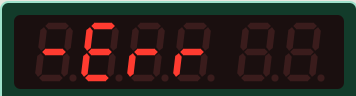

### M: examine and change memory

Press **M**, type a four-digit address, then **N**. The display shows the
address and the byte stored there:

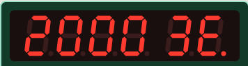

- Type two hex digits to change the byte.
- **N** stores it and moves to the next address:

  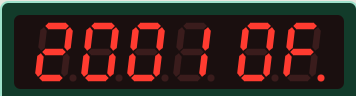

- **M** (inside the command) goes back one address.
- **EX** ends the command.

Memory in the ROM (0000–1FFF) can't be changed: trying shows -Err.

### R: examine and change registers

Press **R**. The display shows register A:

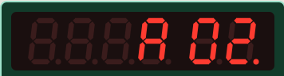

Press **N** to see the next register, in this order: A, B, C, D, E,
F (flags), I (interrupt mask), H, L, SPH, SPL, PCH, PCL. Type new data to
change a register, and **EX** to finish. These are the values the monitor
saved when your program last stopped (with RST 1 or a breakpoint).

### GO: run a program

Press **GO**. The display shows the address the program will start from
(the saved program counter) and the byte stored there. Type a different
address if you want, then press **EX** to run. A program returns to the
monitor with the instruction `RST 1` (code CF); the display then shows the
ready message again.

### SS: single step

Press **SS**, type the start address (or keep the one shown), then press
**N**. The CPU runs **one** instruction and the display shows the next
address and its first byte. Each **N** runs one more instruction; use R to
look at the registers in between. **EX** ends. Single step needs jumper
J13 on.

### Built-in programs

These ROM programs are started with GO *address* EX:

| Address | Program | What the display shows |
|---|---|---|
| 1000 | write memory to tape | `S Ad` (start address), `E Ad` (end address), `S rC` (start the recorder) |
| 1300 | read a tape into memory | `S rC` (start the recorder) |
| 1600 | receive an Intel HEX file | `End` when finished |
| 1800 | choose the port for 1600 | `POrt` and the port number; press 1 or 2, then EX |

---

## 5. The terminal monitor

To use the terminal monitor, switch on **J16 terminal mode** in the jumper
bar and press **RS**. The monitor greets you in the terminal and shows its
prompt, a full stop. Click the terminal and type commands:

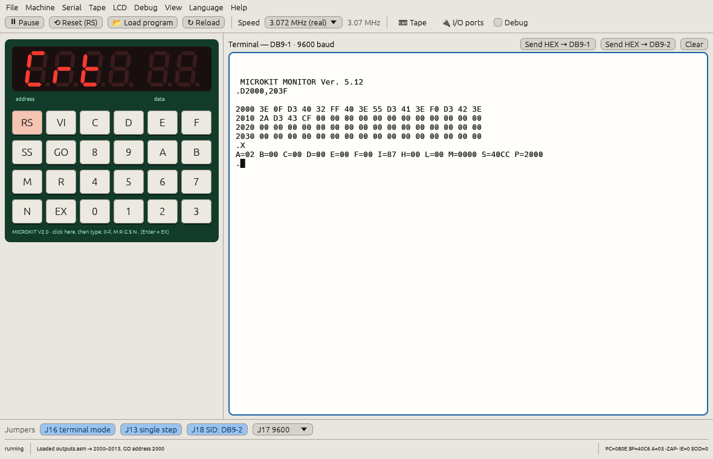

Commands must be in capital letters; **Serial → Type in capitals** (on by
default) does that for you. Press **H** for the help pages:

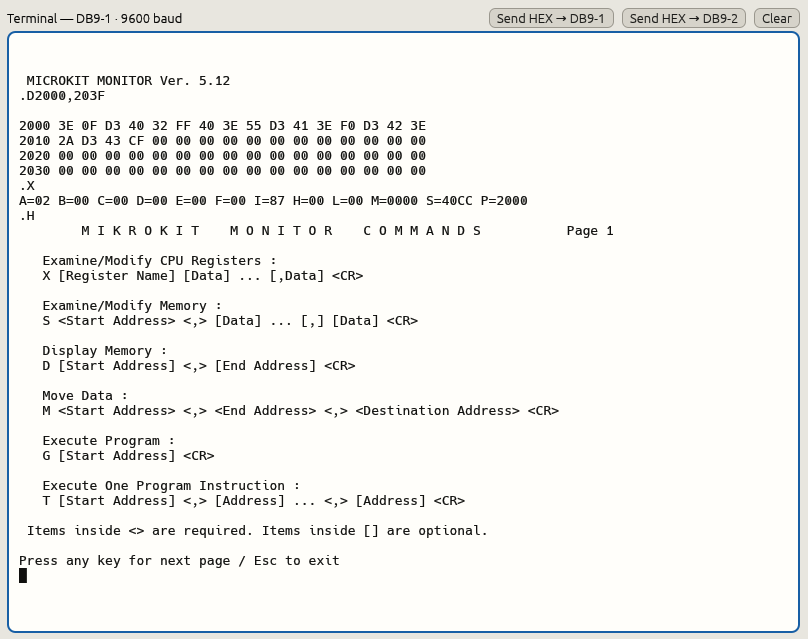

| Command | Meaning |
|---|---|
| `X [reg] [data] … <CR>` | examine/change CPU registers |
| `S addr, [data] … <CR>` | examine/change memory |
| `D [start], [end] <CR>` | display memory |
| `M start, end, dest <CR>` | move (copy) memory |
| `G [address] <CR>` | run a program |
| `T [address], … <CR>` | trace: run one instruction at a time |
| `F start, end, data <CR>` | fill memory |
| `E address <CR> data… <Esc>` | enter bytes into memory |
| `I port, … <CR>` | read an input port |
| `O port, data <CR>` | write an output port |
| `P` | choose the serial port for `L` |
| `L` | load an Intel HEX file |
| `W` | write memory to tape |
| `R` | read a tape |
| `H` | help |
| `B` | Tiny BASIC (only with the Tiny BASIC ROM) |

Items in `<>` are required, items in `[]` are optional. `<CR>` is the
Enter key.

### Typing in the terminal

- **Enter** sends CR, **Backspace**, **Esc** and **Tab** work as usual.
- **Ctrl+C** sends ^C (it stops a BASIC program). If you have selected
  text, Ctrl+C copies it instead.
- **Ctrl+S / Ctrl+Q** send XOFF/XON.
- **Ctrl+V** pastes; pasted text is typed at a person's pace.
- **Right-click** the terminal for *Copy*, *Copy all text*, *Paste*,
  *Send Ctrl+C* and *Clear terminal*.

The real monitor ignores keys pressed while it is printing. The emulator
holds your typing until the monitor has finished printing, so nothing is
lost.

---

## 6. Loading and running programs

### Load program

Use **Load program** (toolbar), **File → Load program**, or drag a file
onto the window. Supported formats:

| File | Contents |
|---|---|
| `.hex` | Intel HEX: the addresses come from the file |
| `.asm` | 8085 assembly source: assembled by the built-in assembler |
| `.bin` | raw bytes: you are asked for the load address |

After loading, the status bar shows where the program went, and the
monitor's saved program counter is set to its start. So in keypad mode just
press **GO** and **EX**, or type **G** and Enter in the terminal.
(You can turn this off in **Debug → Set GO address after loading a
program**.)

**Reload** loads the last file again: edit your source in any text editor,
save it, press Reload, and run it again.

Programs go into RAM (2000–3FFF). Loading into the ROM area is refused.

### The kit's own download

The real kit receives programs over a serial cable. You can do the same in
the emulator:

1. Start the receiving program: **GO 1600 EX** (keypad) or **L**
   (terminal).
2. Send the file: **Send HEX → DB9-2** (the default port of the download
   program) or **Send HEX → DB9-1** after choosing port 1 with
   **GO 1800** (keypad) or **P** (terminal).

### Saving memory

**File → Save memory range** saves a range of addresses as an Intel HEX
or binary file.

---

## 7. Writing your own programs

Write 8085 assembly in the built-in [assembly editor](#the-assembly-editor),
or in any text editor and load the `.asm` file with **Load program**.
A minimal program:

```asm
        ORG 2000H
START:  MVI A,47H       ; A = 47H
        RST 1           ; back to the monitor
        END START
```

Assemble and load it, press GO and EX, then R: register A shows 47.

**End your programs with `RST 1`** (code CF). The monitor then saves all
the registers so you can look at them, and shows its prompt again.

The assembler understands labels (with or without a colon), `EQU`, `SET`,
`ORG`, `DB`, `DW`, `DS`, `END`, strings, character constants, and
expressions with `+ - * / MOD SHL SHR AND OR XOR NOT HIGH LOW`. Numbers can
be written as `2000H`, `0x2000`, `$2000`, `1010B`, `17O` or `17Q`. Errors
are reported with their line number.

To assemble without opening the window:

```bash
mikrokit-emu --assemble program.asm -o program.hex
mikrokit-emu --assemble program.asm -o program.bin --symbols
```

A `.bin` output is a full 8 KB ROM image (0000–1FFF), handy for making your
own monitor ROM.

### The assembly editor

The editor under the keypad is the quickest way to try a program. Type or
paste your code, then press **▶ Assemble & load** (or **Ctrl+Enter** while
typing). The code is assembled, put into RAM, and the GO address is set to
the program's start (the label after `END`, or else its first address),
just as with **Load program**. Then press GO and EX on the keypad, or type
`G` in the terminal.

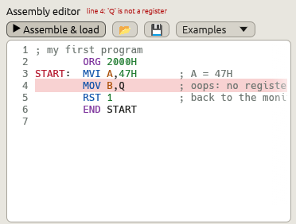

- **Colours** mark the mnemonics, registers, numbers, strings, labels,
  directives and comments.
- **Errors**: the line with the error turns red and the message appears
  next to the title, for example "line 4: 'Q' is not a register". Nothing
  is loaded until you fix it. After a successful load the title shows, in
  green, the addresses filled and the GO address.
- Programs go into RAM (2000–3FFF). A program that starts below 2000H, in
  the ROM, is not loaded and a message explains why.
- **📂** opens an assembly file and **💾** saves the text to a file.
- **Examples** puts one of the example programs into the editor
  (`count.asm`, `outputs.asm`, `ports.asm`, `lcd.asm`). **New (empty
  program)** starts again from a short template. Both replace the text in
  the editor, so save it first if you want to keep it.
- **Right-click** the text for Cut, Copy, Paste and Select all. The usual
  keys work too: Ctrl+X, Ctrl+C, Ctrl+V, Ctrl+A, and Ctrl+Z to undo.
- **Wider editor**: drag the right edge of the left panel to the right.
  Long lines also scroll sideways; the line numbers stay in place.
- The text is kept when you close the program and is there the next time
  you start it.

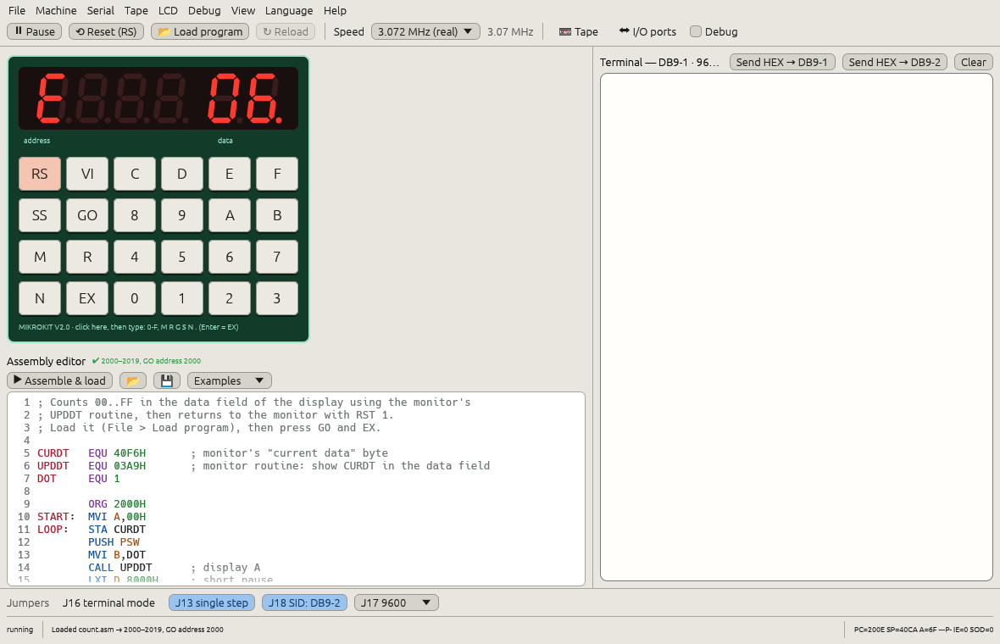

### Example programs

| File | What it does |
|---|---|
| `hello.hex` | puts 47H in register A and returns |
| `count.asm` | counts 00–FF on the display, using the monitor's display routine |
| `ports.asm` | copies the port B switches to the port A LEDs |
| `outputs.asm` | sets all 8155 ports as outputs with a fixed pattern |
| `lcd.asm` | writes four lines on the LCD |
| `leds.bas` | Tiny BASIC: counts in binary on the port A LEDs |
| `lcd.bas` | Tiny BASIC: writes to the LCD and counts 0–999 |

### Useful addresses

| Address | Contents |
|---|---|
| 2000–3FFF | your RAM |
| 4000–40FF | the 8155's RAM; the monitor uses 40CD–40FF |
| 40D3 / 40D6 / 40D9 / 40DC | jump slots for RST 5, RST 6, RST 6.5, RST 7 |
| 40DF | jump slot for VI (RST 7.5) |
| 40E2–40EE | registers saved by the monitor |
| 40FF | copy of the 8155 command register (write it when you change the CSR) |

---

## 8. Monitor ROMs and Tiny BASIC

Choose the ROM in **File → Monitor ROM**:

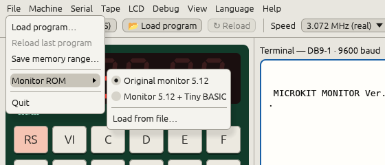

- **Original monitor 5.12**: the kit's own EPROM (the default).
- **Monitor 5.12 + Tiny BASIC**: the same monitor with Palo Alto Tiny
  BASIC added in the ROM's free space.
- **Load from file…**: your own ROM. The last file stays in the menu.

Changing the ROM resets the kit. Both ROMs are built into the emulator.

### Tiny BASIC

With the Tiny BASIC ROM, J16 on (terminal mode) and RS pressed, type **B**
at the monitor prompt:

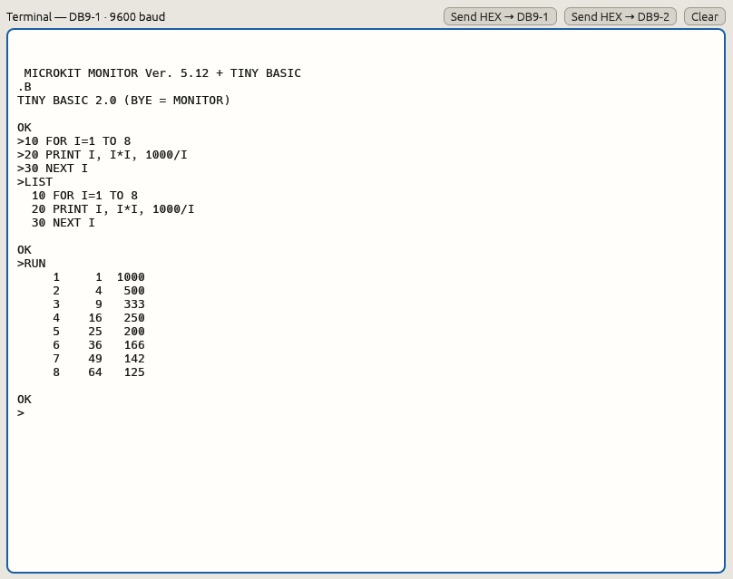

- **Statements**: `LET` (optional), `PRINT`, `INPUT`, `IF` (no `THEN`),
  `GOTO`, `GOSUB`/`RETURN`, `FOR`/`NEXT`/`STEP`, `REM`, `STOP`,
  `POKE addr,value`, `OUT port,value`, `BYE`.
- **Commands**: `RUN`, `LIST [line]`, `NEW`. **Ctrl+C** stops a program.
- **Functions**: `RND(n)`, `ABS(n)`, `SIZE` (free memory), `PEEK(addr)`,
  `IN(port)`.
- Numbers are 16-bit integers (−32768 to 32767). Variables are `A`–`Z`, and
  `@(i)` is an array. `#` means "not equal". Statements can be shortened
  with a full stop: `P.` = `PRINT`.
- Programs live in RAM 2000–3EFF (about 7.9 KB).
- **BYE** returns to the monitor; **B** comes back with your program still
  there.

To load a BASIC program from a text file, use **Send HEX → DB9-1** with a
`.bas` file: the emulator types it in line by line.

---

## 9. The tape recorder

The Mikrokit saves programs on an ordinary cassette recorder. The emulator
has a virtual recorder that saves "tapes" as WAV sound files: you can even
play them into a real Mikrokit, or record a real kit's tape and load it.

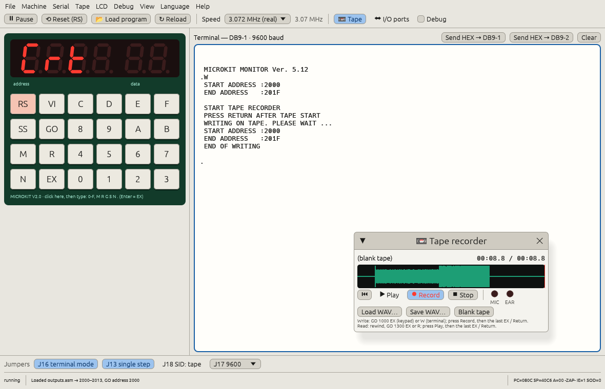

**First set jumper J18 to tape** (click *J18 SID* in the jumper bar so it
says *tape*). The recorder window reminds you if you forget.

### Writing to tape

1. Start the write program: **GO 1000 EX** (keypad) or **W** (terminal).
2. Give the start and end addresses.
3. When the monitor asks you to start the recorder (`S rC` on the
   display), press **Record** in the recorder window, then **EX** (or
   Enter).
4. Wait until the monitor shows its prompt again. **Save WAV…** keeps the
   tape as a file.

### Reading from tape

1. **Load WAV…** (or use the tape you just recorded) and press **⏮**
   (rewind).
2. Start the read program: **GO 1300 EX** or **R**.
3. Press **Play**, then **EX** (or Enter).

The MIC light shows the signal going to the recorder, the EAR light the
signal coming back. Click the waveform to move the tape head.

---

## 10. The I/O ports

The **I/O ports** window (toolbar or View menu) shows the parallel port
connector X2 and the input buffer:

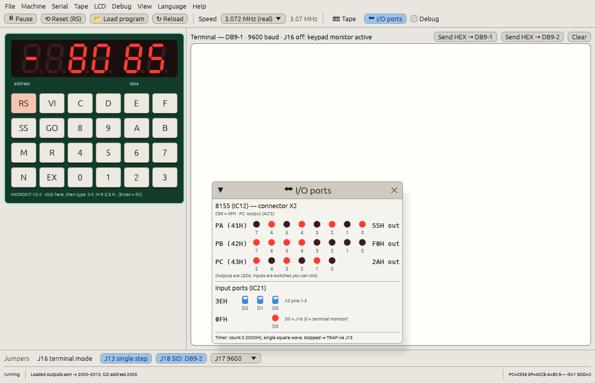

- **Ports A, B and C** of the 8155 (I/O addresses 41H, 42H, 43H). A port
  set as an **output** is shown as red LEDs; a port set as an **input** is
  shown as blue switches you can click. The direction follows the 8155's
  command register (port 40H).
- **Port 3EH**: the three inputs on connector X3 (bits D0–D2).
- **Port 0FH**: jumper J16 on bit D0 (0 = terminal monitor).
- The 8155 **timer**, which the monitor uses for single stepping.

Try `outputs.asm` (all three ports as outputs) and `ports.asm` (switches
on port B light the LEDs on port A).

---

## 11. The LCD

You can connect a **16x2** or **20x4** character LCD (HD44780 compatible)
to the 8155's port B, in 4-bit mode. Choose it in the **LCD** menu:

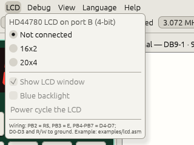

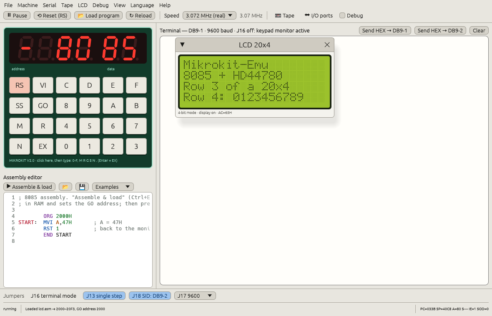

### Wiring

| 8155 pin | Connector X2 | LCD |
|---|---|---|
| PB2 | pin 15 | RS |
| PB3 | pin 16 | E |
| PB4 | pin 13 | D4 |
| PB5 | pin 14 | D5 |
| PB6 | pin 11 | D6 |
| PB7 | pin 12 | D7 |
| — | ground | D0–D3, R/W |
| — | pins 2, 4 (+5V) / 1, 3 (ground) | power |

### Programming it

- Set port B as an output: write 02H to the 8155 command register
  (port 40H), and keep a copy at 40FFH.
- Send each byte as two halves (the high four bits first) on PB4–PB7, with
  RS on PB2 (0 = command, 1 = character), and pulse E (PB3) high then low
  for each half.
- Start-up: send 3, 3, 3, then 2 (as single halves) to switch the LCD to
  4-bit mode, then the commands 28H (2 lines), 0CH (display on), 01H
  (clear) and 06H (move right).
- Because R/W is tied to ground, a program can't ask the LCD whether it is
  ready; it has to wait: about 40 µs after each byte and 1.6 ms after
  Clear (01H) or Home (02H). If your program is too fast, the LCD window
  shows a warning: a real LCD might lose those bytes.

`examples/lcd.asm` shows all of this; `examples/lcd.bas` does the same in
Tiny BASIC (BASIC is slow enough to need no delays).

The menu also offers a **blue backlight** and **Power cycle the LCD**.
Before a program sets it up, a real LCD shows a row of dark blocks; the
emulated one does the same.

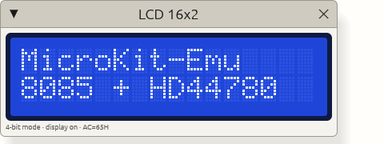

The LCD shows all the standard characters (codes 20H–7FH), the eight
characters you can design yourself (codes 00H–07H), and a few symbols from
the upper half (°, µ, Ω, π, the solid block). The Japanese katakana
characters are shown blank.

---

## 12. The debug panel

Open it with **Debug** on the toolbar:

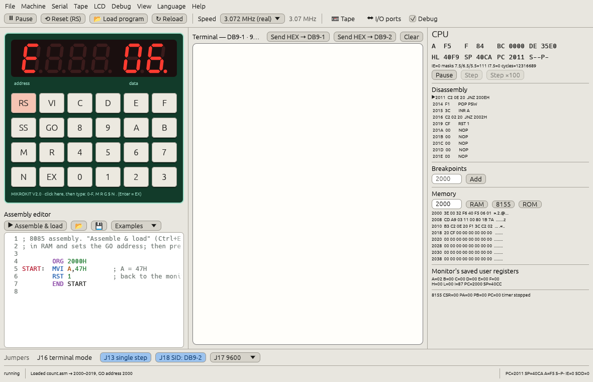

- **CPU**: all registers, the flags, and the interrupt state.
- **Pause / Run, Step, Step ×100**: stop the CPU and run one or a hundred
  instructions.
- **Disassembly**: the next instructions; ▶ marks the current one, ● a
  breakpoint.
- **Breakpoints**: type an address and press Add. The CPU pauses when it
  reaches it.
- **Memory**: 64 bytes from any address (quick buttons for RAM, the 8155
  and ROM).
- **Monitor's saved user registers**: what the R command will show.
- The state of the **8155** ports and timer.

**Turbo** speed (toolbar) runs the CPU as fast as your computer can, which
is handy for long BASIC programs. Timing-dependent things (the tape, the
serial port on DB9-2) still work, because they follow the emulated clock.

---

## 13. Jumpers

The jumper bar at the bottom changes the board's jumpers; the **Machine**
menu has the same settings.

| Jumper | Setting | Effect |
|---|---|---|
| **J16** | on / off | terminal monitor / keypad monitor (press RS after changing it) |
| **J13** | on | the 8155 timer drives TRAP (needed for SS and T) |
| **J18** | DB9-2 / tape | SID and SOD go to serial port DB9-2 or to the tape interface |
| **J17** | position 1–11 | baud rate of DB9-1: 9600 (position 1), 4800, 2400, 1200, 600, 300 … |
| **J14** | on | the 8155 RAM is enabled at 4000H |

The other jumpers on the board (J1–J12) set interrupt pull-downs and the
memory chip types. The emulator is fixed at the standard setting: 2764
EPROM and 6264 RAM.

---

## 14. Appearance and language

- **View → Follow the system / Dark / Light** chooses the colours. In the
  light theme the terminal shows dark text on a light background:

  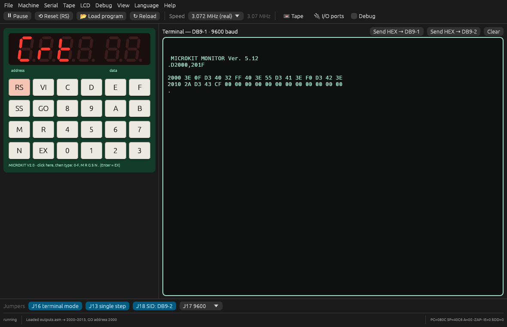

- **Language → English / Ελληνικά** switches the whole program between
  English and Greek. Text printed by the kit itself (the monitor, BASIC)
  stays as the ROM has it.
- **View** also opens the tape recorder, the I/O ports window and the
  debug panel.

---

## 15. Reference tables

### Memory map

| Addresses | Contents |
|---|---|
| 0000–1FFF | monitor ROM (2764 EPROM) |
| 2000–3FFF | user RAM (6264) |
| 4000–40FF | 8155 RAM (repeated through 47FF); the monitor uses the top part |

### I/O ports

| Port | Device |
|---|---|
| 0FH | J16 (bit 0) |
| 1EH / 1FH | 8251 data / control-status (DB9-1) |
| 2EH / 2FH | 8279 data / control (keypad, display) |
| 3EH | inputs X3 (bits 0–2) |
| 40H | 8155 command/status register |
| 41H / 42H / 43H | 8155 ports A / B / C |
| 44H / 45H | 8155 timer (low / high) |

### Interrupts

| Interrupt | Source | Monitor sends it to |
|---|---|---|
| TRAP | 8155 timer (through J13) | single step |
| RST 7.5 | VI key | 40DF |
| RST 6.5 | X1 connector | 40D9 |
| RST 5.5 | 8279 (keypad) | the monitor |

### Keyboard shortcuts

| Key | Keypad mode | Terminal |
|---|---|---|
| 0–9, A–F | hex digits | typed |
| M, R, G, S | M, R, GO, SS | typed |
| N, Space, comma | N | typed |
| . or Enter | EX | Enter = CR |
| F9 | RS | RS |
| F10 | VI | VI |
| Ctrl+C | — | ^C, or copy the selection |
| Ctrl+V | — | paste |

In the assembly editor the keys type text, and **Ctrl+Enter** assembles
and loads the program.

---

## 16. Troubleshooting

| Problem | Solution |
|---|---|
| Nothing happens when I type | Click the part you want to type into (the board or the terminal); it gets a coloured frame. |
| The terminal stays empty | Turn on *J16 terminal mode* and press RS. |
| The monitor ignores my commands | Commands must be in capitals; keep *Serial → Type in capitals* on. |
| Single step does nothing | J13 must be on. |
| The tape doesn't record or read | J18 must be set to *tape*. Press Record/Play **before** the last EX. Rewind before reading. |
| A download doesn't arrive | Send to the port the download program is listening on (DB9-2 by default; choose with GO 1800 or P). |
| My program doesn't return | End it with `RST 1`. Press RS to get the monitor back. |
| The LCD shows dark blocks | The program hasn't set it up yet, or port B isn't an output. |
| The LCD window warns about busy writes | Add delays: 40 µs per byte, 1.6 ms after Clear/Home. |

---

*MikroKit-Emu. The Mikrokit was designed by Micro Design Ltd. Tiny BASIC
is Palo Alto Tiny BASIC by Li-Chen Wang and Roger Rauskolb (1976).*
